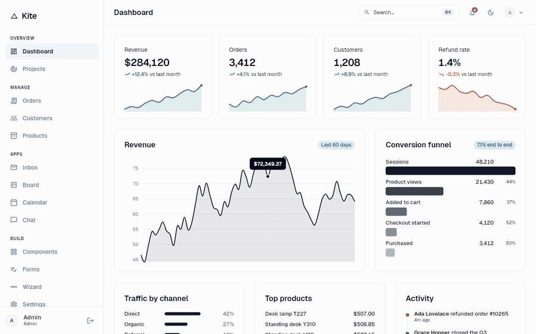
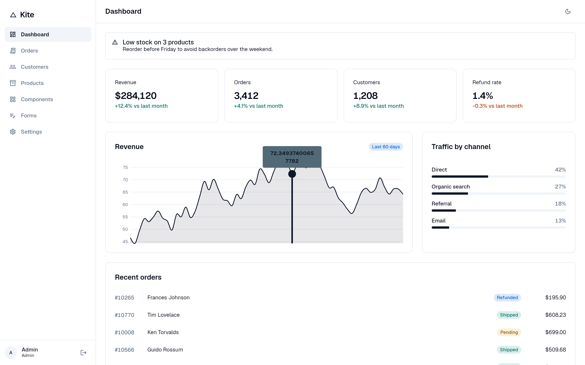
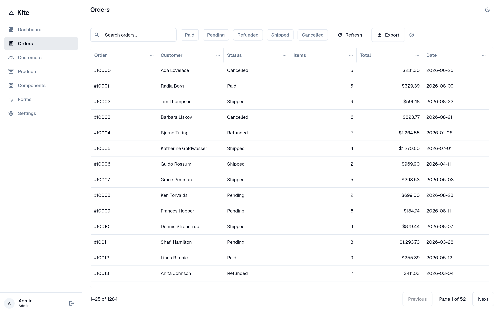

<!--
  README ORDER IS DELIBERATE: preview links, product description, packages,
  animated demo, then onboarding and reference material.
  See docs/DISTRIBUTION.md. Add video/store links only when they exist.
-->

# Kite — Flutter Admin Dashboard Template

## [Live Preview](https://demo.dashboardpack.com/kite/) · [Documentation](https://docs.dashboardpack.com/kite-docs/) · [Get started](#getting-started)

[](https://github.com/ColorlibHQ/kite-flutter-admin-dashboard/actions/workflows/ci.yml)
[](LICENSE)
[](https://docs.flutter.dev/install)

Kite is a free, MIT-licensed **Flutter dashboard template** for teams building
an admin panel alongside their Flutter app. Keep your models, API client, and
Dart expertise in one stack, with editable source from the app shell to the UI widgets.

This **Flutter admin dashboard template** targets web, iOS, Android, macOS, and
Windows. Start with seeded data and explore the interface without an API key,
backend project, or account to create.

Build a **Flutter web dashboard**, SaaS back office, ecommerce management
interface, or internal operations tool with responsive layouts, charts, data
tables, and CRUD forms. The included Dart source and reusable components let
you adapt the dashboard to your own application and design system.

**Built with:** [shadcn_ui](https://pub.dev/packages/shadcn_ui) ·
[go_router](https://pub.dev/packages/go_router) ·
[Riverpod](https://pub.dev/packages/flutter_riverpod) ·
[fl_chart](https://pub.dev/packages/fl_chart) ·
[trina_grid](https://pub.dev/packages/trina_grid)



*Light and dark themes, ⌘K command search across records, paginated resource
management, a draggable board, and a component showcase. Recorded from the app.*

## Why build on Kite?

- **Working resource management.** Orders, customers, and products share list,
  detail, create, and edit screens with search, filtering, sorting, and pagination.
- **A backend seam you can replace.** The five-method `DataProvider` contract
  has mock, REST, and Supabase/PostgREST implementations. Resource screens,
  command search, and dashboard record lists use that interface.
- **A reusable UI package.** `packages/kite_ui/` owns design tokens, inputs,
  cards, charts, and the themed data grid. It stays a local path dependency so
  you can change the widgets directly.
- **Layouts for different screens.** A desktop sidebar, mobile bottom
  navigation, and resource card lists adapt the navigation and data views.
- **Themes and localization.** System/light/dark modes, slate/blue/violet
  accents, and persistent preferences. Auth, settings, and resource flows have
  English, Spanish, French, Japanese, and Arabic translations, including RTL.
  Sample dashboards and app content still include English.
- **Real auth and roles.** Optional Supabase Auth, secure native session storage,
  token refresh, email verification, password recovery, and server-managed
  Viewer/Editor/Admin roles with tested row-level security policies.
- **Keyboard navigation.** Open command search with ⌘K or Ctrl+K. Auth redirects
  preserve bookmarked destinations through sign-in.
- **Checks beyond compilation.** CI checks formatting, analysis, tests,
  package isolation, generated docs, seven release build variants, and web font
  and bundle-size regressions.

## Getting started

Use **Flutter 3.47.8 / Dart 3.13.7**, the versions pinned for CI. Dart ships with
Flutter. Check your target platform's tooling with `flutter doctor`.

```bash
git clone https://github.com/ColorlibHQ/kite-flutter-admin-dashboard.git
cd kite-flutter-admin-dashboard
flutter pub get
flutter run -d chrome
```

### Demo login

Open the [live preview](https://demo.dashboardpack.com/kite/) or run the app
locally without backend configuration. If the sign-in screen appears, use the
prefilled sample account and click **Sign in**:

| Field | Demo value |
| --- | --- |
| Email | `admin@kite.dev` |
| Password | `password` |

No registration or email verification is needed for the demo. These public
credentials apply only to the mock authentication mode; they do not grant access
to a Supabase project. Production sign-in screens offer a separate public-demo
link. Set `--dart-define=KITE_PREVIEW_URL=https://your-demo.example/` to customize
it, or `--dart-define=KITE_PREVIEW_URL=` to hide it in a private deployment.

With no backend configuration, the demo sign-in form is prefilled. Any
valid-looking email works; no password is verified. Demo sessions and edits
reset on restart. Theme, accent, and language preferences persist on the device.

To open directly on the dashboard for a demo:

```bash
flutter run -d chrome --dart-define=KITE_DEMO=true
```

Prefer FVM? The repository includes `.fvmrc`; run `fvm install`, then prefix
Flutter commands with `fvm`, for example `fvm flutter run -d chrome`.
Use `flutter devices` and select `-d macos`, a connected phone, or another
available target to explore native layouts.

## Explore the template

| Area | Included |
| --- | --- |
| Dashboards | Revenue, product and order views; project progress, milestones, and team summaries |
| Resources | Orders, customers, products; shared CRUD forms and tables |
| Authentication | Sign-in, sign-up, password reset, verification, and lock-screen examples |
| Apps | Inbox, draggable kanban board, calendar, and chat examples |
| Build | Component showcase, form controls, multi-step wizard |
| Account & system | Settings, profile, 404, and server-error screens |

Visit **Components** to inspect the design system, **Orders** to try the data
layer, and **Settings** to change themes and locale.

### Preview

| Dashboard | Resource management |
| --- | --- |
|  |  |

### What needs your backend?

The mock adapter implements CRUD over seeded in-memory records. REST and
Supabase adapters are integration starting points, not hosted backend services.
Configure Supabase Auth and apply the included role migration for verified
identities, session persistence, and server-enforced permissions. Dashboard
metrics and app examples such as chat and inbox include sample data and local
interactions; they are not connected messaging or analytics services.

## Connect your data

### REST without editing source

```bash
flutter run -d chrome --dart-define-from-file=config/production.local.json \
  --dart-define=KITE_API_URL=https://api.example.com
```

[`lib/core/data/data_source.dart`](lib/core/data/data_source.dart) selects the
REST adapter when `KITE_API_URL` is set and attaches the current auth token.
With Supabase Auth configured, it otherwise selects Supabase data; the
zero-configuration demo uses seeded mock data. HTTP clients are disposed with
their provider. Your REST API must validate tokens and enforce permissions.
For an explicit remote-data demo, use `KITE_DEMO=true` without production auth.

The adapter expects these endpoints for each resource:

```text
GET    /orders?_page=1&_limit=25&_sort=total&_order=desc&q=ada&status=Paid
GET    /orders/10004
POST   /orders
PATCH  /orders/10004
DELETE /orders/10004
```

Lists accept either an array with an `X-Total-Count` header or an envelope:

```json
{"data": [{"id": "10004", "reference": "ORD-10004"}], "total": 1284}
```

Return the total across **all matching records**, not just the current page.
For cross-origin web APIs, allow the frontend origin and expose
`X-Total-Count` through CORS. Adapt endpoint names, payloads, and authenticated
headers in [`rest_data_provider.dart`](lib/core/data/rest_data_provider.dart).

### Run the local Supabase integration tests

A local stack with confirmation enabled and captured email is configured in
`supabase/config.toml`. With Docker and Supabase CLI available:

```bash
node tools/local-supabase.mjs start
node tools/configure-local-supabase.mjs
node tools/auth-e2e.mjs
flutter run -d chrome --web-port 8722 \
  --dart-define-from-file=config/supabase.local.json
```

The test runner uses actual Auth and PostgREST services, checks confirmation,
password sign-in, recovery, all role levels and revocation, then cleans up its
synthetic fixtures. Email stays in local Mailpit at `http://127.0.0.1:57424`.
It rejects hosted endpoints. After confirming your local account, use
`node tools/local-role.mjs you@example.test admin` to assign its role.
See [local setup details](docs/AUTHENTICATION.md#local-end-to-end-environment).

### Production authentication and Supabase

1. Apply [`supabase/migrations/202610270001_kite_auth_roles.sql`](supabase/migrations/202610270001_kite_auth_roles.sql) to a new Supabase project.
2. Configure email/password Auth, SMTP, confirmation, and the allowed callback URLs.
3. Copy [`config/production.example.json`](config/production.example.json) to `config/production.local.json` and set your project URL, public client key, and callback URL.
4. Assign your first administrator through the SQL editor; new accounts receive no resource access automatically.

```bash
flutter run -d chrome --web-port 8722 \
  --dart-define-from-file=config/production.local.json
```

| Role | Read | Create/update | Delete |
| --- | --- | --- | --- |
| Unassigned | No | No | No |
| Viewer | Yes | No | No |
| Editor | Yes | Yes | No |
| Admin | Yes | Yes | Yes |

The UI hides unavailable actions and guards write routes. The protected role
table and database policies enforce access on the server and prevent users from
promoting themselves. These policies cover one shared workspace, not multiple tenants.
See the [authentication and roles guide](docs/AUTHENTICATION.md) for role assignment,
recovery links, secure storage, native callbacks, and staging verification.

Use a custom `DataProvider` for another API and an `AuthRepository` for another
identity service. Build-time values are visible in distributed apps; use public
client keys and keep server credentials on your backend.

## Make it yours

| Change | Start here |
| --- | --- |
| Navigation and routes | `lib/core/router/routes.dart`, `lib/core/router/app_router.dart` |
| Resource fields and forms | `lib/features/resources/resource_schema.dart` |
| Backend selection | `lib/core/data/data_source.dart` |
| Authentication | `lib/core/auth/session.dart`, `lib/features/auth/` |
| Theme and design tokens | `lib/core/theme/app_theme.dart`, `packages/kite_ui/lib/src/tokens.dart` |
| Translations | `lib/l10n/app_*.arb`, then `flutter gen-l10n` |
| Shared shell | `lib/shared/layout/` |
| Web title, metadata, icons | `web/index.html`, `web/manifest.json`, `web/icons/` |

To add a resource, define its `ResourceSpec`, register its routes and navigation,
and implement that resource in your data adapter. Existing resource screens
reuse the schema. See [adding a resource](https://docs.dashboardpack.com/kite-docs/resources.html).

Keep direct `shadcn_ui` imports inside `packages/kite_ui/`. App screens import
`package:kite_ui/kite_ui.dart`; the named design-library bridge is
`package:kite_ui/shadcn.dart`.

## Project structure

```text
lib/
  core/             Auth, roles, preferences, routing, data, theme and locale state
  features/         Dashboard, resources, apps, forms, and account screens
  shared/           App shell and shared loading/error/empty states
  l10n/             Translation sources and generated localizations
packages/kite_ui/   Reusable UI package and standalone example
test/             Behavior and HTTP adapter tests
docs/src/         Documentation source fragments
docs/site/        Generated documentation site
tools/            Docs builder, recording, font and bundle tools
```

## Develop and verify

```bash
dart format .
flutter analyze --fatal-infos
flutter test --coverage
flutter pub outdated
python3 tools/check-l10n.py
python3 tools/build-docs.py
npm ci --prefix tools/policy-tests
npm test --prefix tools/policy-tests
```

Check the UI package independently when changing shared widgets:

```bash
cd packages/kite_ui
flutter pub get
flutter analyze --fatal-infos
flutter test --coverage
```

The app lockfile is committed for reproducible builds. Run `flutter pub upgrade`
when intentionally refreshing compatible dependencies. Weekly Dependabot updates
cover Dart packages, policy-test tooling, and GitHub Actions. `trina_grid` currently constrains
`shadcn_ui` to 0.55.x; upgrading beyond that requires an upstream compatibility
update. No dependency overrides are required.

Accessibility tests check editable-field labels, contrast, touch targets, keyboard
submission, validation announcements, all action variants across six theme
combinations, and all five auth/settings locales at 200% text size. They do not replace a full assistive-technology audit.

Contribution details live in [AGENTS.md](AGENTS.md). Include the behavior changed,
validation performed, and screenshots for visual changes in pull requests.

## Build and deploy

```bash
# JavaScript web release
flutter build web --release

# WebAssembly with JavaScript fallback
flutter build web --wasm --release

# Example: host under /admin/ instead of /
flutter build web --wasm --release --base-href /admin/

# Native releases (require the corresponding platform toolchain)
flutter build apk --release
flutter build ios --release --no-codesign
flutter build macos --release
flutter build windows --release
```

Deploy the contents of `build/web/`. Configure your host to serve `index.html`
for application routes so refreshing `/orders/10004` works. Pass your data
configuration again at build time. Keep `KITE_DEMO` for demonstration builds.

For the same font optimizations checked by CI, run
`node tools/strip-fonts.mjs build/web` and
`python3 tools/subset-lucide.py build/web` after building; the latter requires
`fonttools`. See [tools/README.md](tools/README.md) and [deployment notes](docs/DEPLOY.md).

## Frequently asked questions

### Is Kite a free Flutter admin dashboard template?

Yes. Kite is open source under the MIT license, with editable Dart source for
the dashboard app and its local UI package. Personal and commercial projects
are allowed under the [license terms](LICENSE).

### Can I connect the dashboard to my existing backend?

Yes. Use the REST adapter for an existing HTTP API or the Supabase adapter for
PostgREST. Implement `DataProvider` for a different backend without rewriting
the resource screens. See [Connect your data](#connect-your-data).

### Does Kite include authentication and role permissions?

The default preview uses mock authentication. Optional Supabase Auth adds
sign-up, sign-in, email confirmation, password recovery, and server-managed
Viewer, Editor, and Admin roles. Apply the included database migrations to
protect real data; see [authentication setup](docs/AUTHENTICATION.md).

### Can I customize the Flutter dashboard design?

Yes. Change theme tokens and widgets in `packages/kite_ui/`, add screens under
`lib/features/`, and register routes in `lib/core/router/`. Light and dark themes,
three accent palettes, and five locales are included. See [Make it yours](#make-it-yours).

## Documentation & support

- [Full documentation](https://docs.dashboardpack.com/kite-docs/): onboarding, data, routes, theming, localization, and deployment.
- [Authentication and roles](docs/AUTHENTICATION.md): production setup, access policies, and sessions.
- [Changelog](CHANGELOG.md): release history and upgrade notes.
- [Release guide](docs/RELEASING.md): validation, deployment, artifacts, and rollback.
- [Architecture](docs/ARCHITECTURE.md): package boundaries and the data contract.
- [Issues](https://github.com/ColorlibHQ/kite-flutter-admin-dashboard/issues): report bugs with reproduction steps, target platform, and `flutter doctor -v` output.

Documentation sources live in `docs/src/`; regenerate `docs/site/` with
`python3 tools/build-docs.py` after editing them.

## License

[MIT](LICENSE) © [Colorlib](https://colorlib.com), the team behind
[AdminLTE](https://github.com/ColorlibHQ/AdminLTE). Free for personal and
commercial use under the license terms; retain the copyright and license notice.
